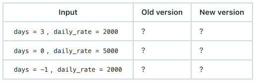

# Software Development Fundamentals — Final Examination (UAS), Session 16

## Part A — Multiple choice (10 questions, 20 points)

```
A1. Which function name best expresses intent for a function that returns the total price of a list of items after member
discount?
(a) calc
(b) process_data
(c) total_price_after_member_discount
(d) doPrices
```
**Answer:** C

```
A2. A function that validates input, computes a price, writes a log file, and sends an email most clearly violates which
principle?
(a) It should do one thing
(b) It should have fewer than three parameters
(c) It should be recursive
(d) It should return a tuple
```
**Answer:** A

```
A3. Which comment is most useful to a future reader?
(a) # increment i by 1
(b) # loops over the list
(c) # Workaround for library issue 1234: it miscounts pages in encrypted files
(d) # TODO: fix this later (2019)
```
**Answer:** C

```
A4. What does a duplicate-code smell most directly increase?
(a) The cost of every future change to that logic
(b) The number of tests required
(c) The runtime of the program
(d) The size of the repository history
```
**Answer:** A

```
A5. A commit message of final is most problematic because
(a) it is too short to search for
(b) it records no reason, so the change cannot be understood without the diff
(c) it should be capitalised
(d) it should include the author name
```
**Answer:** B

```
A6. A pull request modifies an existing test so that it asserts the new behaviour. What is the reviewer’s correct response?
(a) Approve, because the tests pass
(b) Treat it as blocking, because changing the test can convert a defect into a passing suite
(c) Suggest a better test name
(d) Ignore it if the change is small
```
**Answer:** B

```
A7. Which property does a test that asserts result is not None lack?
(a) Speed
(b) Detection power
(c) Readability
(d) Isolation
```
**Answer:** B

```
A8. In the test-driven development cycle, what must happen before any production code is written?
(a) A test that fails for the right reason
(b) A passing test
(c) A refactor
(d) Documentation
```
**Answer:** A

```
A9. Which statement about a bare except: clause is correct?
(a) It is faster than a specific except clause
(b) It hides programming errors by catching everything, including mistakes the program should not recover from
(c) It is required for file handling
(d) It re-raises the exception automatically
```
**Answer:** B

```
A10. library==2.0 and library>=2.0 differ in that
(a) both name exactly one version
(b) only the first states the version that was tested, so only the first is reproducible
(c) only the second can be installed
(d) they are equivalent
```
**Answer:** B


## Part B — Short answers (5 questions, 20 points)

### B1. Explain the difference between an error, a fault, and a failure, using a concrete example from a late-fee calculation.


**Answer:** To explain the difference between error, fault, and failure using concrete example of a late-fee calculations would genereally go as follows:
- Error: The developer misinterprets the rule, believing that grace periods should be subtracted after applying the daily compounding penalty rather than before.
- Fault: The code is written as `lateFee = (daysOverdue - gracePeriod) * dailyRate * 1.05`, failing to properly clamp the term when `daysOverdue <= gracePeriod`.
- Failure: When a user pays an invoice 2 days late (within a 3-day grace period), the system incorrectly charges them a negative or corrupted late fee, or crashes due to a downstream negative balance.


### B2. Explain why a function that takes a mutable default argument such as notes=[] misbehaves across calls, and state the standard fix.


**Answer:** In Python, the default arguments are evaluated once when the function is defined, usually at module load time, not every time the function is called. Using a mutable onject like a list `notes=[]`, that exat same list object will then be shared across every subsequent function call that relies on the default value. If items are appended to it inside the function, they accumulate across calls, leading to unexpected state leakage. Therefore the standard fix is generally the use of `None` as the default sentinel value, and initialize a new list inside the function body if the argument evaluates to `None`.


### B3. Explain the red, green, refactor cycle and state what makes a red test genuinely useful rather than merely failing.

**Answer:** What makes red useful can be seen after understanding what each cycle means in the first place:
- Red: Write a test for a feature or bug fix that does not exist yet, and run it to confirm that it fails.
- Green: Write the minimum amount of production code required to make the test pass successfully.
- Refactor: Clean up the code (remove duplication, improve naming, optimize structure) while ensuring the test stays green.

therefore what makes a red test is useful only when it fails for the right reason (i.e., due to the missing functionality or the specific bug you are targeting). If a test fails because of a syntax error, a misspelled variable, or a broken mock setup, it gives a false signal and provides no valid proof that your subsequent code implementation actually solves the problem.


### B4. A contributor asks for a review. Explain the difference between a blocking finding and a nit, and state why marking the category is part of the reviewer’s obligation.

**Answer:**
- blocking finding in general refers to an issue that genuinely/logically needs to be fixed before a pull request can be merged, think of security, failing tests, etc.
- nitpicking is when a minor, subjective and or non-critical stylistic suggestion is given/demanded, such as when someone asks for it to be 169.9999999995 cm instead of 170 or 169 cm.
And then in terms of why marking the category is an obligation it can be Explicitly labeling feedback prevents ambiguity and reduces friction. It tells the author what is mandatory for merge approval versus what is merely an optional suggestion. Without labels, authors may waste time debating styling choices or feel unnecessarily blocked by subjective opinions.


### B5. Explain why a requirements.txt that lists packages without version constraints is not reproducible, and name the file that the standard approach uses to record the fully resolved set.

**Answer:** Why unconstrained `requirements.txt` is not reproducible is because if a `requirements.txt` lists packages without version constraints (e.g., requests), pip will always fetch the absolute newest available version from the package index at installation time. Because third-party packages frequently release updates containing breaking changes or bug fixes, builds run on different days or environments will pull different versions, leading to "it works on my machine" inconsistencies. The standard file used The standard approach uses a lock file (most commonly named poetry.lock when using Poetry, Pipfile.lock with Pipenv, or generated via pip-compile as `requirements.txt`) to record the fully resolved, exact version hashes and dependency trees of all installed packages.

## Part C — Code reading (3 questions, 30 points)

### C1 — Refactoring (10 points)
```
def proc(d, t, m):
r = []
for i in d:
if i['type'] == 'food':
if m:
r.append({'n': i['n'], 'v': i['v'] * 0.9})
else:
r.append({'n': i['n'], 'v': i['v']})
else:
if m:
r.append({'n': i['n'], 'v': i['v'] * 0.95})
else:
r.append({'n': i['n'], 'v': i['v']})
s = 0
for x in r:
s = s + x['v']
if s > t:
return {'items': r, 'total': s, 'flag': True}
return {'items': r, 'total': s, 'flag': False}
```

#### (a) Name four code smells present, using the course vocabulary, and point to the specific lines that exhibit each.
**Answer:**
1. Cryptic/Obfuscated Naming: Variable names like `d`, `t`, `m`, `r`, `i`, `s`, and `x` fail to express intent.
2. Magic Numbers: Hardcoded discount multipliers (0.9 and 0.95) and hardcoded type strings ('food') are embedded directly into the logic without descriptive constants.
3. Deep Nesting / Arrow Anti-Pattern: Excessive nested if/else conditionals reduce readability and make the flow difficult to follow.
4. Duplicate Code / Mixed Responsibilities: Item transformation and total summation are lumped into a single monolithic block, repeating dictionary key mappings (`n`, `v`) across branches


#### (b) Rewrite the function so that it is readable, removes the duplication, and has no magic numbers. Your version must behave identically, including the case where the total exactly equals the threshold.
**Answer:**
```
FOOD_DISCOUNT_RATE = 0.90
STANDARD_DISCOUNT_RATE = 0.95
ITEM_TYPE_FOOD = "food"

def processItems(items, threshold, isMember):
    processedItems = []
    
    for item in items:
        value = item['v']
        if isMember:
            if item['type'] == ITEM_TYPE_FOOD:
                value *= FOOD_DISCOUNT_RATE
            else:
                value *= STANDARD_DISCOUNT_RATE
                
        processedItems.append({'n': item['n'], 'v': value})

    totalValue = sum(item['v'] for item in processedItems)
    exceedsThreshold = total_value >= threshold

    return {
        'items': processedItems,
        'total': totalValue,
        'flag': exceedsThreshold
    }
```

### C2 — Test quality (10 points)
```
# discounts.py
def apply_discount(price, member):
if price < 0:
raise ValueError("price must not be negative")
return price * 0.9 if member else price
# tests/test_discounts.py
def test_returns_something():
assert apply_discount(100, True) is not None
def test_boolean_result():
result = apply_discount(100, True)
assert result == 90 or result != 90
def test_negative_raises():
with pytest.raises(ValueError):
apply_discount(-1, True)
```

#### (a) Explain, test by test, whether each test has detection power. Name the specific weakness of any test that does not.
**Answer:**
- test_returns_something(): Lacks detection power. Its weakness is weak assertion/tautological validation (checking only that the result is not None). Any function returning an integer, string, or boolean would pass.

- test_boolean_result(): Lacks detection power. Its weakness is tautological/always-true logic (assert result == 90 or result != 90). Because != 90 is always true for any value except 90 (and == 90 covers 90), this assertion evaluates to True for any possible output, meaning it can never fail.

- test_negative_raises(): Has detection power. It correctly verifies that invalid inputs trigger the expected ValueError.

#### (b) Write two additional tests that would catch a regression in which the member discount is removed.
**Answer:**
```
def test_member_discount_applied_to_food():
    # Ensures a member gets the expected discount on items
    assert apply_discount(100, member=True) == 90.0

def test_non_member_no_discount():
    # Ensures non-members do not receive a discount
    assert apply_discount(100, member=False) == 100.0
```


### C3 — Debugging (10 points)
```
def sum_to(n):
"""Return the sum of 0 + 1 + ... + n."""
total = 0
for i in range(n):
total += i
return total
def add_note(note, notes=[]):
notes.append(note)
return notes
```

#### (a) State what sum_to(5) returns and what the docstring says it should return.
**Answer:** sum_to(5) Return vs. Docstring
Returns: 10 (because range(5) iterates through 0, 1, 2, 3, 4, omitting 5).
Docstring states it should return: 15 (0 + 1 + 2 + 3 + 4 + 5).


#### (b) Explain what a caller sees if they write first = add_note("a") and then second = add_note("b") , and why the first variable appears to change.
**Answer:**
What the caller sees: Both first and second evaluate to ["a", "b"].
Why it happens: Due to Python's mutable default argument trap, the list object created at definition time is shared across calls. When second = add_note("b") runs, it appends "b" to the same underlying list referenced by first.

#### (c) State the correct implementation of sum_to in one line or one clearly described loop.
**Answer:**
```
def sum_to(n):
    return sum(range(n + 1))
```

#### (d) State the correct signature and body of add_note , and write one regression test for each of the two defects.
**Answer:**
- Correct signature & Body:
```
def add_note(note, notes=None):
    if notes is None:
        notes = []
    notes.append(note)
    return notes
```
- Regression Tests
```
def test_sum_to_correctness():
    assert sum_to(5) == 15

def test_add_note_does_not_share_state():
    list1 = add_note("a")
    list2 = add_note("b")
    assert list1 == ["a"]
    assert list2 == ["b"]
    assert list1 is not list2
```

## Part D — Case analysis (2 questions, 30 points)

### D1 — Reviewing a pull request (15 points)
A pull request against main contains the following change to a module whose function calculate_late_fee(days, daily_rate) previously raised ValueError for negative days , returned 0 for days == 0 , and otherwise returned days

```
* daily_rate .
-def calculate_late_fee(days, daily_rate):
- if days < 0:
- raise ValueError("days must not be negative")
- if days == 0:
- return 0
- return days * daily_rate
+def calculate_late_fee(days, daily_rate):
+ if days == 0:
+ return 1
+ return days * daily_rate + 1
```

The pull request description states: This is a small, safe change that does not affect any existing behaviour.

#### (a) Compute the value returned by the old and the new version for each of the three inputs below, and state which of them changed.


**Answer:** 
All of them changed:
| Input | Old Version | New Version | Changed? |
| :--- | :--- | :--- | :--- |
| `days = 3`, `daily_rate = 2000` | $6000$ | $6001$ | Yes |
| `days = 0`, `daily_rate = 5000` | $0$ | $1$ | Yes |
| `days = -1`, `daily_rate = 2000` | Raises `ValueError` | $-1999$ | Yes |


#### (b) State whether the description is accurate, and name three findings that a reviewer must raise, classifying each as blocking, suggestion, or nit.
**Answer:**
Is the description accurate? No, the description is completely inaccurate. The change alters behavior across every single tested case, introducing silent data corruption (off-by-one errors) and removing input validation for negative numbers. Three Findings include:

- Removal of negative input validation / broken contract: The new code allows negative days and incorrectly calculates a negative fee plus 1 instead of raising a ValueError. (Classification: Blocking)

- Altered baseline behavior for zero days: A zero-day overdue fee now evaluates to 1 instead of 0. (Classification: Blocking)

- Inaccurate PR description / misleading claims: The author claims the change is "small, safe" and "does not affect any existing behaviour," which violates transparency and puts the codebase at risk of silent regressions. (Classification: Blocking)


#### (c) Write one review comment in the problem, impact, suggestion form for the most serious finding.
**Answer:**
- Problem: The PR modifies calculate_late_fee to return 1 when days == 0 instead of 0, adds a flat + 1 offset to all calculations, and completely removes the defensive ValueError check for negative inputs.
- Impact: This silently breaks existing business logic, charges customers incorrect late fees, causes zero-day invoices to incur unexpected charges, and allows invalid negative day arguments to process corrupt arithmetic.
- Suggestion: Revert these mathematical modifications back to the original logic, restore the if days < 0: exception guard, and ensure all existing unit tests are kept intact.

### D2 — Project hygiene (15 points)
A repository is in the following state.
```
README.md : "This is my project. Run main.py"
.gitignore : absent
.env : API_TOKEN=xyz987 (committed, present in history)
requirements.txt : numpy
pandas
numpy>=2.0
matplotlib
tests/ : absent
```

#### (a) List the three fixes you would make first, in order, and justify the order by naming the consequence of delaying each.
**Answer:**
1. Revoke and rotate the exposed API token immediately, then add .env to a new .gitignore file.
Consequence of delaying: Anyone with access to the repository history can steal the live API token (xyz987) and abuse the connected third-party service, leading to immediate security breaches.

2. Create and populate a proper .gitignore file (ignoring .env, build artifacts, and cache directories).
Consequence of delaying: Future developers or automated scripts might accidentally commit more environment files, logs, or local configuration files.

3. Add a tests/ directory with an initial test suite framework.
Consequence of delaying: Code changes will have zero automated verification, making regressions difficult to catch and preventing reliable continuous integration (CI).

#### (b) Explain why deleting .env in a new commit is not sufficient. 
**Answer:**
Git records a complete history of all past commits. Simply deleting the file in a new commit removes it from the current working tree, but the file and its secret contents remain permanently embedded in Git's object database history. Anyone who clones the repository can easily run commands like git log -p or git checkout to recover the token. To fully resolve this, you must scrub the history using tools like git-filter-repo or BFG Repo-Cleaner after rotating the token.

#### (c) Explain what is wrong with requirements.txt as written, naming both problems.
**Answer:**
1. Conflicting/Redundant Version Constraints: numpy is listed twice—once unconstrained and once with >=2.0. This causes ambiguity, as pip may resolve conflicting versions depending on parsing order.

2. Lack of Pinning / Full Resolution: Packages are specified loosely or without exact version locks (e.g., pandas, matplotlib), meaning installations will pull the latest available versions from the package index, breaking reproducibility across different environments and deployment dates.